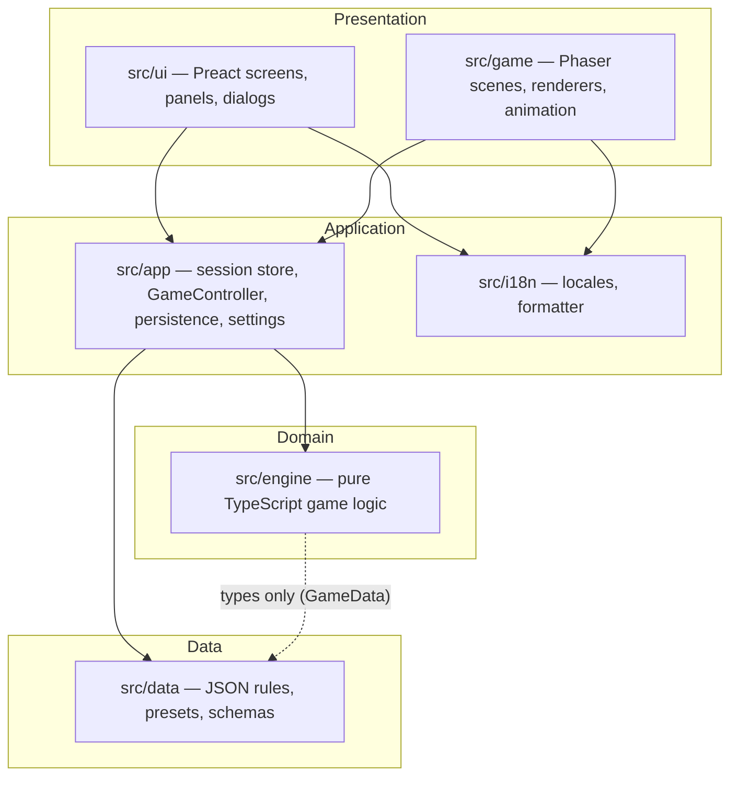

# Architecture — «Закріпи! Готово! Рух!»

| Field | Value |
|---|---|
| Document version | 0.1 |
| Date | 2026-10-20 |
| Based on | `PRD.md` v0.1 (MVP scope) |
| Status | **Draft** — target architecture for milestones M0–M6; art and asset pipeline intentionally out of scope |

This document explains **how** the system described in `PRD.md` is built. The PRD stays the single source of truth for **what** the game does. References like `§14.2` point to PRD sections. When this document and the PRD disagree, the PRD wins, and the conflict is recorded in `docs/DECISIONS.md`.

> **Out of scope for this draft:** everything about art and assets (asset manifest, sprite and texture formats, palettes, recolouring, placeholders, asset loading, the asset spec for art agents, the `/dev/assets` page). The art is still being generated. Only the `/assets/` folder is reserved in the repository layout. A later revision will add an assets section once the art set is known.

---

## 1. Architectural drivers

These PRD requirements shape the architecture the most:

1. **Headless, pure engine** (§0.2.1, §20.3): all game rules run without Phaser or the DOM, so they can be unit- and scenario-tested.
2. **Determinism** (§0.2.2, §22.4, §24.2.10): same scenario + seed + action history ⇒ deep-equal final state.
3. **Data-driven rules** (§0.2.3, §21): every probability, distance, duration and rating lives in validated JSON, editable by an instructor.
4. **Strict equipment accountability** (§0.2.5, §9.2): items are never created, destroyed or teleported; invariants are checked after every step.
5. **Explainability** (§14.2.4, §16.3, §17): every outcome must be explained to the player through typed events that reference rule and knot ids.
6. **Full bilingual UI** (§19): the engine never produces text, only i18n keys with parameters.
7. **Future obstacles** (§3.2, §25): positions, routes and actions must already support obstacle chains and new obstacle types.

---

## 2. System overview

The game is a static, client-only single-page application (§22.6: no backend, no network calls after load). It has four layers. Dependencies point **downwards only**.



1. **Data** — JSON files and their JSON Schemas. They contain no logic.
2. **Domain (engine)** — pure functions over plain, serializable state. It does not use I/O, time, `Math.random`, the DOM or Phaser.
3. **Application** — connects the engine to the outside world: it owns the current session, calls the engine, autosaves to `localStorage`, loads and validates data, and handles settings.
4. **Presentation** — Preact handles all forms, panels and menus (DOM overlay). Phaser renders the hill scene. Both read state from the application store and send user intents to the controller.

### 2.1 Dependency rules (enforced by lint)

1. `src/engine/**` must not import from `src/game`, `src/ui`, `src/app`, `src/i18n`, `phaser` or `preact`. This is enforced with ESLint `no-restricted-imports` (or `eslint-plugin-boundaries`).
2. `src/engine/**` must not use `Math.random`, `Date`, `performance`, `window`, `document` or `localStorage`. This is enforced with `no-restricted-globals` / `no-restricted-properties`.
3. `src/game/**` and `src/ui/**` never mutate engine state. They only call the controller (for commands) or read-only engine queries (`getActionOptions`, `evaluateKnot`, `getStats`).
4. `src/game` and `src/ui` do not import each other. They communicate only through the application store.

---

## 3. Repository layout

This extends PRD §20.2 with the application layer (`src/app`) and the internal structure of each folder.

```
/PRD.md                     product requirements (source of truth)
/docs/
  ARCHITECTURE.md           this document
  DECISIONS.md              assumptions & deviations from the PRD (ADR-lite log)
  data-authoring.md         guide for instructors editing JSON (§21.5)
  CHANGELOG.md              milestone demo notes (§23)
/src/
  engine/
    model/                  entity types, ids, Position, ItemLocation, GameState
    geometry/               s ↔ (x, y), elevation, sections, adjacency
    data/                   GameData type + typed accessors (no file loading)
    scenario/               createGame(), scenario validation, initial placement
    actions/                one module per action: <action>.ts + registry.ts
    resolution/             resolveStep(), phase pipeline, step-start snapshot
    knots/                  context derivation, evaluateKnot(), functional effects
    hazards/                fall chance, protection chains, rockfall, injury
    protocol/               command protocol checker (P1–P7)
    stats/                  counters & derived stats
    invariants/             assertInvariants()
    rng/                    seeded PRNG + roll recorder / scripted rolls (tests)
    events/                 GameEvent union + builders
    index.ts                public API (createEngine)
  data/
    *.json                  knots, contexts, hazards, rules, actions, commands, protocol, equipment
    presets/hills/*.json, presets/kits/*.json
    schemas/*.schema.json
    load.ts                 imports JSON, validates with Ajv, builds GameData
  app/
    store.ts                session store (Preact signals)
    controller.ts           GameController: plan → resolve → animate → autosave
    persistence/            localStorage repositories, import/export, migrations
    settings.ts             language, term hints, pixel scale, sound
  i18n/
    uk.json, en.json, i18n.ts
  game/
    scenes/                 Boot, Preload, Hill
    render/                 terrain, parallax, members, ropes, bases, items
    anim/                   event → animation timeline
  ui/
    screens/                one folder per screen of §6.1
    panels/                 member cards, journal, top bar
    dialogs/                action picker, knot dialog
    components/             pixel-styled primitives
/assets/                    game art (reserved; structure defined later, see note at the top)
/tests/
  engine/unit/              per-module tests
  engine/scenarios/         §24.2 scenario tests (scripted plans + seeds)
  data/                     schema & cross-reference validation, locale completeness
  e2e/                      Playwright smoke tests
```

---

## 4. Domain layer (`src/engine`)

### 4.1 Public API

The engine has no module-level state. It is a factory bound to a validated `GameData` object. This keeps tests free to inject modified rules (for example, a hazards file with a forced probability) without global mocks. The functions it returns are exactly the API in §20.3:

```ts
export function createEngine(data: GameData): Engine;

export interface Engine {
  createGame(scenario: Scenario): GameState;
  getActionOptions(state: GameState, memberId: MemberId): ActionOption[];
  validatePlan(state: GameState, plan: PlannedAction[]): PlanValidation;
  resolveStep(state: GameState, plan: PlannedAction[], opts?: ResolveOptions): StepResult;
  evaluateKnot(input: KnotEvalInput): KnotEvaluation;
  getStats(state: GameState): Stats;
  getOutcome(state: GameState): Outcome;
  replay(scenario: Scenario, history: PlannedAction[][]): GameState;
}

export interface ResolveOptions {
  rolls?: RollScript;        // tests only: force specific random outcomes by roll key
  checkInvariants?: boolean; // default: true in dev/test, false in prod
}
```

The application creates a single default engine instance, bound to the bundled data, at startup.

### 4.2 State model

`GameState` is one plain JSON-serializable object, normalised by id. It contains no classes, functions, `Map`s or cyclic references. This makes `structuredClone`, deep-equal comparison, autosave and replay trivial.

```ts
interface GameState {
  schemaVersion: number;
  scenario: Scenario;                  // immutable copy of the configuration
  step: number;
  rng: RngState;                       // e.g. { algo: "mulberry32", s: 123456789 }
  outcome: Outcome;
  simTimeS: number;
  members: Record<MemberId, MemberState>;
  items: Record<ItemId, ItemState>;    // the id set never changes after createGame (§9.2.2)
  ropes: Record<ItemId, RopeLayout>;   // only ropes that are currently in use
  knots: Record<KnotId, KnotInstance>;
  bases: Record<BaseId, BaseState>;
  attachments: Record<AttachmentId, Attachment>;  // self-belays / holds
  belays: Record<BelayId, BelayRelation>;
  hazards: { pendingRockfalls: PendingRockfall[] };
  protocol: ProtocolState;             // recent commands, open "windows"
  stats: StatsCounters;
  log: GameEvent[];                    // full journal
}
```

Key modelling decisions:

1. **Position** is always `{ obstacleIndex: number; s: number }`, even though MVP has one obstacle (§5.2.6).
2. **Item location** is a discriminated union. It is the only place an item's location is stored. Every other structure references items by id.
   ```ts
   type ItemLocation =
     | { kind: "carried"; memberId: MemberId }
     | { kind: "worn"; memberId: MemberId }
     | { kind: "in_use"; structure: StructureRef }   // rope layout, base, knot, attachment, belay
     | { kind: "on_ground"; pos: Position };
   ```
3. **Rope layout** is an ordered list of `RopeNode`s (§9.4). Each node points to what it is attached to (`member_harness`, `base`, `belay`, `held`, `free`). Fixed-rope segments are **derived** by a selector, never stored, so they cannot get out of sync.
4. **Member weight** and **member status flags** that can be computed from state (carried weight, "is protected", "is in a safe zone") are selectors in `model/selectors.ts`, not stored fields.
5. `Member.abilities` exists as `{}` in the type, but no engine module reads it (§8.5). A lint rule or unit test can guard this.

### 4.3 Geometry (`engine/geometry`)

1. `buildHillGeometry(obstacle)` precomputes cumulative section boundaries, `(x, y)` vertices and elevation for each vertex. The result is memoised by obstacle identity, not stored in state.
2. Queries: `sectionAt(pos)`, `toWorld(pos)`, `elevationAt(pos)`, `isAdjacent(a, b)`, `isBelow(a, b)`, `zoneAt(pos)` (`start` | `summit` | `finish` | `slope`).
3. "Below", "downhill" and "fall line" always use **elevation**, not `s`. On the descent side of an `ascent_descent` route, `s` grows while elevation falls (see §11, issue 3).
4. Rendering uses the same module (`toWorld`) through the read-only selectors. This guarantees that the picture matches the rules.

### 4.4 Actions (`engine/actions`)

Each player action from §11 is one module that implements a common interface and is registered in `registry.ts`:

```ts
interface ActionDef<K extends ActionKind, P> {
  kind: K;
  phase: ResolutionPhase;                                  // §10.2 slot
  enumerate(ctx: ReadCtx, m: MemberId): ActionOption[];   // parameter space for the UI picker
  validate(ctx: ReadCtx, m: MemberId, p: P): Validation;  // physical preconditions only
  assess(ctx: ReadCtx, m: MemberId, p: P): SafetyHint[];  // unsafe-but-possible hints (learning mode)
  apply(tx: StepTx, m: MemberId, p: P): void;              // effects, emits events
  durationS(ctx: ReadCtx, p: P): number;                   // from actions.json
}
```

1. `validate` returns `{ ok: false, reasonKey, params }` for **physically impossible** actions. The UI shows them disabled with that reason (§0.2.6).
2. `assess` returns hints for **unsafe but possible** actions. It never blocks an action. Learning mode shows the hints, exam mode hides them (§17).
3. Validation runs twice: when the plan is built (`validatePlan`), and again inside resolution against the state *as it is at that phase*. An earlier phase may have changed the state, for example by passing away the carabiner the member planned to use. A plan that becomes invalid mid-step emits an `action.failed` event and counts as a forced skip. It never throws.
4. `StepTx` is the mutable working copy for this step. It also exposes `emit(event)`, `roll(key, p)` and `snapshot` (see §4.5.3).

### 4.5 Step resolution (`engine/resolution`)

```mermaid
sequenceDiagram
    participant C as GameController
    participant R as resolveStep
    participant P as Phases (§10.2)
    participant I as assertInvariants
    C->>R: (state, plan)
    R->>R: tx = structuredClone(state); snapshot = protection at step start
    loop phases 1..8
        R->>P: run(tx, actionsOfPhase)
        P-->>R: mutations + events
    end
    R->>R: phase 9: stats, outcome, simTime
    R->>I: assertInvariants(tx.state)
    R-->>C: { state: newState, events }
```

1. **Purity.** `resolveStep` deep-clones the input (`structuredClone`) and mutates only the clone. In dev/test the input state is deep-frozen, so any accidental mutation throws at once.
2. **Phase pipeline.** The pipeline is a fixed, ordered array that maps one-to-one to §10.2: `commands → detach/transfer → bases/knots → attachments → belays → movement → hazardRolls → hazardResolution → bookkeeping`. Inside each phase, members are processed in **team order** (scenario order), so random rolls always happen in the same sequence.
3. **Step-start snapshot (§10.3).** Before phase 1 the resolver records a `ProtectionSnapshot`: active attachments, belays (with the belayer and braking method), and bases with their anchors. Hazard resolution only accepts protection that exists in **both** the snapshot and the current state. Protection must have existed at step start, and must not have been removed or failed during this step. This rule lives in one place.
4. **Distracted belayer** (§11.3.3) is computed in the `belays` phase. If a belayer has a non-command action this step, the relation is marked `inactiveThisStep`.
5. **Rockfall timing** (§14.4) uses `hazards.pendingRockfalls`. Each entry has `createdStep`. A `rock` command in step N or N+1 resolves it as "warned". Otherwise the hit rolls happen at the end of step N+1.
6. **Duration** is `max(durationS of executed actions, rules.minStepSeconds)` (§10.4).
7. **Invariants** run last. In dev/test a violation throws `InvariantViolation` with a diff. In production it is logged and the step is still returned, so the game is not bricked.

### 4.6 Randomness (`engine/rng`)

1. **PRNG**: `mulberry32` (32-bit state, tiny and fast). Its state is stored in `GameState.rng`, and every draw advances it.
2. **Named rolls.** Every draw goes through `tx.roll(key, p)`, where `key` is semantic, for example `fall:terrain:m2`, `chain:m2:knot:k7:shock`, `rockfall:dislodge:m4` or `injury:m2`. The roll result and probability are attached to the event that explains it, so the player can see, for example, "fall chance was 9 %".
3. **Scripted rolls (tests only).** `ResolveOptions.rolls` maps roll keys to forced outcomes. When a key is forced, the PRNG is **still advanced**, so the rest of the sequence is unchanged. Scenario tests such as "forced roll, fall not caught" (§24.2.6) use this without having to search for magic seeds.
4. **Replay.** `replay(scenario, history)` runs `createGame` and then `resolveStep` for each recorded plan. Determinism tests compare the result with the saved final state using deep equality (§24.2.10).

### 4.7 Knots (`engine/knots`)

1. **Context derivation.** `deriveContext(target)` maps what is tied to what onto a context id (§13.3). For example: rope end + own harness ⇒ `TIE_IN_END`, and rope + base with a large tree ⇒ `ANCHOR_THICK`. The player never chooses the context.
2. **`evaluateKnot(input)`** is a pure function (§13.5). It looks up the rating in `contexts.json` (falling back to `default`), takes base probabilities from `hazards.json`, then applies additive modifiers in a fixed order, capped at 1.0. Each modifier adds a `messageKey` and a `ruleId`. The UI hint and the engine use the same function, so the hint always matches what actually happens.
3. **Functional effects** (§13.6) are separate from probabilities. Examples are Гарда blocking rope feed in `BELAY_LOWER` and the extra untie time. They are implemented as small rule hooks that the movement and detach phases consult.
4. **Exam mode** does not change the evaluation. The evaluation is stored on the `KnotInstance`, and its visibility is decided in the presentation layer (`revealed` flag set when the knot is first loaded).

### 4.8 Hazards (`engine/hazards`)

1. **Fall chance** (§14.1) is a product of named factors: `baseByAngle × surface × mistakes × method`. Each factor is recorded, so the explanation can list exactly which mistakes raised the chance.
2. **Protection chains** (§14.2). Every protection type builds a `ChainElement[]` list: harness → carabiner → knot → segment → anchoring knots → base, or tie-in → rope → intermediate carabiners → braking → belayer base. One generic `rollChain(tx, chain, loadType)` rolls each element and returns the first failure (if any). Each protection type then decides the result: caught in place, slide to the lower node, caught after a fall of length *L*, or try the next protection.
3. **Recursion.** A belayer who is pulled off (§14.2.2.6) is resolved as a new fall, using their own protection. A depth guard (team size) prevents loops.
4. **Unprotected slide** uses `geometry` to find the first section below 20° along the downhill direction.
5. **Injury → outcome.** `injured` immediately sets `outcome = "lost"` at the end of the step (§14.5). Other events in the same step still resolve, so the journal stays complete.

### 4.9 Protocol checker (`engine/protocol`)

1. `protocol.json` holds the rule ids (P1–P7), severities, parameters (windows, `maxMembersPerSegment`) and message keys.
2. Each rule id maps to a checker function in code (`checkers/P1.ts` …). Data can tune and turn rules on or off. New *kinds* of rules need code, and the documentation says so (`data-authoring.md`).
3. The checker reads `ProtocolState` (recent commands per member and recipient, segment-ready flags). It runs in the bookkeeping phase, except where a violation feeds a fall multiplier (P1/P2/P4). In those cases the movement phase asks the checker in advance. See §11, issue 1.

### 4.10 Events (`engine/events`)

`GameEvent` is a discriminated union, and every event has the same envelope:

```ts
interface GameEventBase {
  id: string;                 // `${step}:${seq}` — stable for React/Preact keys and replay diffs
  step: number;
  phase: ResolutionPhase;
  type: string;               // e.g. "member.moved", "fall.caught", "knot.failed", "protocol.violation"
  severity: "info" | "hint" | "warning" | "danger";
  messageKey: string;         // i18n key
  params: Record<string, string | number>;
  refs: { members?: MemberId[]; items?: ItemId[]; knots?: KnotId[]; ruleIds?: string[]; rolls?: RollRecord[] };
}
```

Events serve three consumers: the **Journal** (text), the **animation timeline** (Phaser), and **stats / learning summary** (§16.3). The engine never formats text.

### 4.11 Invariants (`engine/invariants`)

`assertInvariants(state)` checks every rule in §9.2 and returns a list of violations (the dev wrapper throws):

1. The item id set equals the set recorded at `createGame`.
2. Every item has exactly one location, and that location's target exists. Every `in_use` reference is answered by the structure that holds it (two-way consistency).
3. Rope length: Σ path distance between nodes + `knotRopeAllowanceM × knots` ≤ `lengthM`.
4. Carabiner load ≤ `maxThingsPerCarabiner`.
5. No member carries more than `maxKg`.
6. Movement of locations happened only between adjacent positions. This is checked by comparing with the previous state, so the check is `assertTransition(prev, next)`.

---

## 5. Data layer (`src/data`)

1. Every JSON file has a JSON Schema in `schemas/`. `load.ts` imports the files statically (Vite bundles them), validates them with **Ajv**, and runs **cross-reference checks** that a schema cannot express: every knot referenced in `contexts.json` exists, every `nameKey` exists in both locales, and so on (§21). The result is a frozen, typed `GameData`.
2. Validation runs at startup in dev builds, and always in CI (`tests/data`). Production builds skip Ajv at runtime to save bundle size, because CI already guarantees validity. Imported **user** scenarios are always validated at runtime with `scenario.schema.json`.
3. TypeScript types for data are generated from the schemas (`json-schema-to-typescript`) so the two cannot drift.
4. Hill presets and kits are ordinary scenario fragments that use the same schemas.

---

## 6. Application layer (`src/app`)

### 6.1 Session store

One store, built with Preact signals, holds:

1. `route` — the current screen (§6.1) and its parameters.
2. `draftScenario` — the scenario that the configuration screens are editing.
3. `session` — `{ scenario, state, history: PlannedAction[][], plan: PlannedAction[], pendingEvents, animating }`.
4. `settings` — locale, term hints, pixel scale, sound, phrase-choice option (§12.2.3).

Both Preact components and the Phaser scene subscribe to it. Phaser subscribes through a small adapter that triggers scene updates.

### 6.2 GameController

The only component that calls state-changing engine functions:

1. `setPlannedAction(memberId, action)` — updates `plan` and re-runs `validatePlan` to refresh disabled reasons and hints.
2. `executeStep()` — `resolveStep(state, plan)` → push to `history` → set new `state` → hand `events` to the animation timeline → autosave → reset `plan` to "skip" for every member.
3. `giveUp()`, `restart()`, `editScenario()`.
4. Applies the **language-practice option** (§12.2.3). If the wrong phrasing is chosen, the controller turns the command action into a "misunderstood" variant. This keeps the engine unaware of the UI quiz.

### 6.3 Persistence

| Key (`localStorage`) | Content |
|---|---|
| `zgr.v1.settings` | settings |
| `zgr.v1.scenarios` | saved scenarios (by id) |
| `zgr.v1.current` | in-progress game: `{ scenario, history, state, savedAt }` |
| `zgr.v1.results` | last 50 results (§6.2.3) |

1. Every record has a `schemaVersion`. `persistence/migrations.ts` upgrades old records step by step.
2. Restoring an in-progress game loads `state` directly (fast). In dev builds it also replays `history` and compares the two, which catches determinism bugs early.
3. All storage access is wrapped in try/catch with a quota check. Storage failure must never crash the game.
4. Import/export uses JSON files validated against `scenario.schema.json` and `results.schema.json`.

---

## 7. Presentation layer

### 7.1 DOM UI (`src/ui`, Preact)

1. Screens follow §6.1 one-to-one and are switched through `store.route`.
2. The game screen is a DOM overlay on top of the Phaser canvas: member cards (bottom), journal (right) and top bar. Only the hill viewport is canvas.
3. The **action picker** is generated from `getActionOptions`, so new actions show up automatically. The **knot dialog** lists every knot grouped by category, and shows `evaluateKnot` hints in learning mode only.
4. Keyboard first (§22.5): every control is reachable by Tab, `1–9` selects members, Enter runs «Виконати крок», and focus is trapped in dialogs.
5. Pixel styling uses CSS with integer scaling variables shared with the canvas scale.

### 7.2 Phaser rendering (`src/game`)

1. **Configuration**: internal resolution 480×270, `pixelArt: true`, integer zoom from settings or auto (§18.1.2).
2. **Scenes**: `Boot` (config), `Preload` (loading; details depend on the art set), `Hill` (the world).
3. **Renderers** are stateless functions of `(GameState, geometry)` plus the loaded art:
   1. Terrain: a filled polygon from `geometry.toWorld` vertices, one surface style per section (§18.2.3).
   2. Parallax background layers per season.
   3. Members.
   4. Ropes: polylines through rope nodes, with sag on free segments and taut fixed segments. Self-belay lines run from harness to rope.
   5. Bases, trees and dropped items.
4. Until the art is ready, renderers draw simple shapes with Phaser `Graphics`. How real art is plugged in is left for the assets revision.
5. **Animation timeline** (`game/anim`) turns a step's `GameEvent[]` into a sequence of tweens (move, tie, shout bubble, fall/slide, caught, injured). It interpolates between `prevState` and `nextState`. While it plays, the store's `animating` is set and «Виконати крок» is disabled. A "skip animation" key jumps to the final state.
6. **Camera** follows the selected member, with pan and 1×/2× zoom (§18.4.1).

### 7.3 Internationalisation (`src/i18n`)

1. Message format: ICU MessageFormat via `intl-messageformat`, with `Intl.PluralRules` for the Ukrainian one / few / many forms (§19.5).
2. `t(key, params)` and `<T k=... />` are the only way to show text. A missing key in dev renders `⟦key⟧`. CI fails on any key missing in either locale (§24.2.15).
3. Term hints (§19.3) use a `<Term k="term.fixed_rope" />` component. It renders the active locale, and either a hover tooltip or an inline Ukrainian original depending on the settings.
4. Commands in speech bubbles always use `uk`. In `en` mode a translation line is shown under the bubble (§19.4).

---

## 8. Quality, testing and CI

| Level | Tool | What |
|---|---|---|
| Unit | Vitest | geometry, each action's `validate`/`apply`, `evaluateKnot` modifiers, chain rolls, protocol checkers, invariants (one test per §9.2 rule) |
| Scenario | Vitest | every case of §24.2 as a scripted `Scenario + PlannedAction[][] + RollScript`, asserting outcome, events and stats |
| Property | Vitest + fast-check | random valid plans never break invariants. Replaying a random history always gives a deep-equal state |
| Data | Vitest + Ajv | schema validity, cross-references, locale completeness |
| E2E smoke | Playwright | navigate all screens, configure and start the default preset, run a few steps, switch locale mid-game |
| Perf | Vitest bench | `resolveStep` < 50 ms for 7 members (§22.2) |

1. CI (GitHub Actions) runs `lint → typecheck → test → build → e2e`, then deploys `main` to GitHub Pages.
2. A small **scenario DSL** (`tests/engine/scenarios/dsl.ts`) keeps tests readable, for example `step({ m1: tie("rope1", "providnyk_visimka_odnym"), m2: belay("m1", "lower", "uiaa") })`.
3. A **headless runner** (`npm run sim -- scenario.json history.json`) prints the journal in `uk`/`en`. Agents and reviewers can use it to debug rules without a browser.

---

## 9. Extensibility for post-MVP scope

1. **Obstacle chains** (§25.1). `Route.obstacles[]` and `Position.obstacleIndex` already exist. The geometry module dispatches on `obstacle.type`. Moving between obstacles is a geometry concern: the finish zone of one obstacle is the start zone of the next.
2. **New obstacle types** (vertical rock, ravine, river). Each adds a `geometry/<type>.ts`, its own surfaces and hazards in data, and new action modules registered in the registry, such as rappel or Tyrolean traverse. The resolver and UI picker need no change.
3. **New knots, contexts and ratings** need only data changes (§26.2).
4. **Evacuation instead of loss** (§25.5). This replaces the `injured ⇒ lost` rule in one place (`hazards/injury.ts` + `getOutcome`).

---

## 10. Key architectural decisions (summary)

| # | Decision | Rationale |
|---|---|---|
| 1 | Engine is a factory `createEngine(data)` and keeps the §20.3 API | Tests can inject data, and there is no global state |
| 2 | Normalised, plain-JSON `GameState`; derived things (segments, weight, protection status) are selectors | Serialisation, deep-equal, no stale duplicates |
| 3 | `structuredClone` + mutate the clone inside `resolveStep`, deep-freeze input in dev | Pure from outside, simple code inside, no Immer dependency |
| 4 | Step-start `ProtectionSnapshot` | Implements §10.3 in exactly one place |
| 5 | Named rolls + scripted rolls that still advance the PRNG | Explainable probabilities and deterministic, readable scenario tests |
| 6 | One generic protection-chain roller | All fall types (§14.2) share one consistent algorithm |
| 7 | Preact DOM for UI, Phaser only for the world, shared signal store | Forms and accessibility in DOM (§20.1.3), clean separation |
| 8 | Engine emits i18n keys only | Instant locale switch, including for past journal entries |
| 9 | Ajv at dev-time and CI only, plus runtime validation for user imports | Smaller production bundle without losing safety |

---

## 11. PRD issues found while designing

These are inconsistencies or gaps in `PRD.md` v0.1. Each one should be resolved by the owner, or recorded as an assumption in `docs/DECISIONS.md`. The proposed assumption is what the architecture currently follows.

1. **Protocol violations and physics (§12.2.2 vs §14.1.2).** §12.2.2 says violations other than P5 have no physical consequences. §14.1.2.3–4, however, makes P1/P2/P4 multiply fall probability. *Assumption:* §14.1.2 wins. P1/P2/P4 raise fall chance, and nothing else changes.
2. **Stats list only P1–P5 (§16.1.6)**, while §12.2.1 defines P1–P7. *Assumption:* stats count every rule defined in `protocol.json`.
3. **"Below" is defined by `s` (§14.2.2.2, §14.4.2).** On the descent side of an `ascent_descent` route, a lower `s` means **higher** elevation. *Assumption:* "below" and the fall line use elevation (`geometry.isBelow`), and fall length uses the path distance along `s`.
4. **Repository layout (§20.2)** places `PRD.md` in `/docs/`, but it is currently at the repository root. *Assumption:* it stays at the root, and docs link to `../PRD.md`. Alternatively, move it.
5. **Section numbering.** §8 has two items numbered 5. In §17.4 the descent tactic is numbered 6 and placed outside the list. References like `§8.5` are therefore ambiguous. *Proposal:* renumber in the next PRD revision.
6. **Backpack weight is listed as future scope (§25.6)**, but it is already part of MVP (§9.5). *Proposal:* remove it from §25.6.
7. **Rope weight while partly paid out (§9.5.3).** A rope stays fully on the carrier until it is `in_use`. The point where a rope that is being paid out to a climbing leader becomes `in_use` is not defined. *Assumption:* a rope becomes `in_use` as soon as one of its ends is tied to a harness or base.
8. **Rope retrieval by the last member (§17.4.5)** depends on "ascends on upper belay … retrieving the rope". The rope's bottom node must move with the member. No action in §11 does this explicitly. *Assumption:* untying the bottom end turns that node into `member_harness` (re-tie), and the rope's nodes follow the member's movement.
9. **The `hold` command and P7 (§12.2.1.7).** The PRD does not define "loads the rope" as a game state. *Assumption:* the rope is loaded when a member is `fallen_caught`, or hangs on a rope segment on ≥ 35° terrain (as in §13.6.2).
